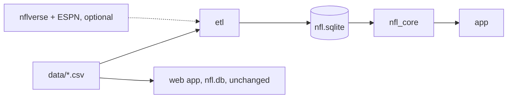

# Design Document: Native Play Viewer

## Overview

A cross-platform Rust app (egui/eframe) for browsing, filtering and animating NFL Big Data Bowl dropback plays, with role-based player stats. It sits next to the existing web replay app, which stays unchanged. Source of truth: `plan.md`.

Environment: Linux x86_64, rustc 1.93.0. Android toolchain is not installed (install only with user consent). iOS is built manually on macOS.

## Architecture

One Cargo workspace. The root package `nfl-analizer` (web app) gains only `[workspace]` (`members = ["etl", "nfl_core", "app"]`, `resolver = "2"`) and `[workspace.dependencies]`.

| Crate | Kind | Responsibility |
|---|---|---|
| `nfl-analizer` (root) | bin `timeline` | Existing web app, untouched, owns `nfl.db` |
| `etl` | bin (desktop) | CSV + enrichment → `data/nfl.sqlite` (temp file + rename), copy to `app/assets/` |
| `nfl_core` | lib, GUI-free | Schema, models, read-only DAL, filters/facets, stats, blob codec, geometry, teams, style tokens |
| `app` | lib + bin, `cdylib`/`staticlib`/`lib` | egui UI, screens, platform entry points, DB path resolution |



Dependency rules: `app → nfl_core`; `etl → nfl_core`; no new crate depends on the root package, and the root package depends on none of them. One `rusqlite = { version = "=0.32.1", features = ["bundled"] }` in `[workspace.dependencies]` (matches Cargo.lock / libsqlite3-sys 0.30.1). All other versions pinned with `=`. Dev-dependency: `proptest` (pinned).

## Reuse map

Logic is ported (copied and improved) into the new crates, never imported from the root package.

| Source | Target | Change |
|---|---|---|
| `src/db.rs` `cell()` (NA → NULL) | `etl::csv_load::cell` | Also maps tracking `None` event → NULL |
| `src/db.rs` `import_csv` loop, one tx per file | `etl::csv_load` | Typed per-table column lists instead of header-derived tables |
| `src/db.rs` `import` temp file + rename | `etl::main` | Writes `data/nfl.sqlite.building`, renames on success |
| `src/db.rs` `fill_schedule` (`old_game_id`, location, stadium) | `etl::enrich::schedule` | Adds `home_score`, `away_score`, `overtime`; warns instead of failing |
| `src/logos.rs` `espn_url`, `download` | `etl::enrich::logos` | `LA→lar`, `WAS→wsh`; 128×128 PNG via `image` |
| `src/game.rs` row helpers (`int`, `real`, `text`), game/play query shapes, role logic | `nfl_core::dal`, `nfl_core::stats` | Read-only connection, typed structs |
| `timeline/viewer.html` `TEAM_COLORS`, `RESULTS`, role colors, field colors/geometry, `isLight` (luminance > 0.35) | `nfl_core::teams`, `nfl_core::style`, `nfl_core::geometry` | Copied exactly; test compares against parsed `viewer.html` |

## Improvements over plan.md

- Team-color test parses `TEAM_COLORS` from `viewer.html` at test time, so drift is caught automatically.
- ETL builds into a temp file and renames, so a failed run never leaves a half-written DB.
- Blob codec is a pure function pair with property tests (round-trip within quantization, NULL sentinel preserved).
- Facet counts come from one generic "filter minus own dimension" query builder, so the "counts sum to Any" invariant holds by construction and is property-tested.
- Layout decision fixed: landscape field on phones and desktop; portrait shows the field rotated 90° via the same mapping (single code path, both tested).

## Components and Interfaces

### nfl_core

```rust
pub mod schema  { pub const SCHEMA_VERSION: i32; pub fn create_all(c: &Connection) -> Result<()>; }
pub mod teams   { pub struct TeamInfo { abbr: &'static str, name: &'static str, primary: Rgb, secondary: Rgb }
                  pub const TEAMS: [TeamInfo; 32]; pub fn team(abbr: &str) -> Option<&'static TeamInfo>; }
pub mod style   { pub type Rgb = (u8,u8,u8); pub type Rgba = (u8,u8,u8,u8);
                  pub const BG: Rgb = (0x0B,0x15,0x26); /* surface, navy, red, field, result, role tokens */ }
pub mod blob    { pub fn encode(frames: &[Vec<EntityPos>]) -> Vec<u8>; pub fn decode(b: &[u8], slots: usize) -> Result<Vec<Vec<EntityPos>>>; }
pub mod geometry{ pub fn normalize(p: EntityPos) -> EntityPos;          // x'=120-x, y'=53.3-y, θ'=(θ+180)%360
                  pub fn angle_vec(deg: f32) -> (f32, f32);             // (sin θ, cos θ)
                  pub fn lerp_frame(a: &[EntityPos], b: &[EntityPos], t: f32) -> Vec<EntityPos>;
                  pub struct Viewport { w: f32, h: f32, portrait: bool }
                  pub fn field_to_screen(v: &Viewport, x: f32, y: f32) -> (f32, f32);
                  pub fn hit_test(ents: &[(Option<i64>, f32, f32)], p: (f32, f32), r: f32) -> Option<i64>;
                  pub fn first_down_x(los: f32, ytg: i32) -> (f32, bool /*goal*/);
                  pub fn is_light(c: Rgb) -> bool; pub fn phase_markers(ev: &[PlayEvent], s: &PlaySummary) -> Vec<Marker>; }
pub mod dal     { pub struct Db; impl Db { fn open_ro(path) -> Result<Db>; fn games(); fn teams(); fn plays_for_game(gid);
                  fn play(gid, pid); fn player(nfl_id); fn frames(gid, pid) -> Result<(Vec<PlayEntity>, Vec<Vec<EntityPos>>)>; } }
pub mod filter  { pub struct PlayFilter { game, week, team, side, pass_result, dropback_type, down, quarter, coverage, coverage_type, play_action, nfl_id }
                  pub struct FacetOption { value: Option<String>, label: String, detail: String, count: u32 }
                  impl Db { fn query_plays(&self, f: &PlayFilter) -> Result<Vec<PlayRow>>; fn facet(&self, d: Dim, f: &PlayFilter) -> Result<Vec<FacetOption>>; } }
pub mod stats   { pub enum Role { Passer, PassBlock, PassRush, Route, Coverage }
                  impl Db { fn player_role(id) -> Result<Role>; fn player_stats(id) -> Result<PlayerStats>; } }
```

`EntityPos { x: f32, y: f32, s: f32, o: Option<f32>, dir: Option<f32> }`. Blob: per frame, per slot, 5 × `u16` LE (x, y centi-yards; s centi-yd/s; o, dir deci-degrees; `0xFFFF` = NULL), optionally `lz4_flex`-compressed.

### etl

`main --data <dir> --out <path> [--offline] [--fixtures]` → `create_all` → `csv_load` (games, players, plays, pff_scouting) → `tracking` (per file: group by play, normalize, entities, blob, events dedup manual > auto, summary, player_play_stats) → `enrich` (schedule, logos; warn on failure) → `VACUUM`, `user_version`, rename, print size, copy to `app/assets/nfl.sqlite`.

### app

`AppState { screen: Screen, stack: Vec<Screen>, db: Result<Db, String>, filter, plays, facets, viewer: ViewerState, player: Option<PlayerStats> }`, `enum Screen { Filters, Viewer{gid,pid}, Player{nfl_id} }`. `ViewerState { frame: f32, playing: bool, speed: f32 }` with `tick(dt)`; repaint only while playing. Entry points: desktop `main`, `android_main(AndroidApp)` (feature-gated), iOS entry. `db_path()` per platform: desktop CLI arg / `NFL_DB` env / `data/nfl.sqlite`; Android asset copy to `internal_data_path()` when `user_version` differs; iOS bundle path opened `immutable=1`.

## Data Models

Tables per plan.md: `games` (+ `location`, `stadium`, `home_score`, `away_score`, `overtime`), `players`, `plays`, `pff_scouting`, `teams` (+ `logo_png`), `play_entities`, `play_frames`, `play_events`, `play_summary`, `player_play_stats`, with the listed indexes. `PRAGMA user_version = SCHEMA_VERSION`.

## Error Handling

- All functions return `Result`; no `unwrap()` outside tests/entry points.
- Missing DB or schema-version mismatch → app shows a message screen.
- Enrichment download failures → warning, columns stay NULL, ETL succeeds.
- Malformed blob length → `decode` returns `Err`.
- SQL uses bound parameters only.

## Correctness Properties

*A property is a characteristic or behavior that should hold true across all valid executions of a system—a formal statement about what the system should do.*

### Property 1: Blob round-trip

For any frame set with x ∈ [0,120], y ∈ [0,53.3], s ∈ [0,40], optional o/dir ∈ [0,360), decode(encode(f)) equals f within 0.005 yd / 0.005 yd/s / 0.05°, and NULL angles stay NULL.

**Validates: Requirements 3.2, 3.3**

### Property 2: Normalization is an involution

For any position, normalize(normalize(p)) equals p within float tolerance, and normalized positions stay inside the field.

**Validates: Requirements 3.4**

### Property 3: Angle to unit vector

For any angle θ, angle_vec(θ) has length 1 and equals (sin θ, cos θ); angle_vec(θ + 360) equals angle_vec(θ).

**Validates: Requirements 7.2**

### Property 4: Facet counts sum to Any

For any seeded DB and any filter, for each single-choice facet dimension, the option counts sum to the "Any" count, which equals query_plays with that dimension cleared; zero-count options come last.

**Validates: Requirements 5.2, 5.3**

### Property 5: Interpolation bounds

For any two frames and t ∈ [0,1], each interpolated coordinate lies between the endpoints, t=0 and t=1 return the endpoints.

**Validates: Requirements 7.3**

### Property 6: Hit-test returns nearest within radius

For any entity set and point, hit_test returns the nflId of the closest non-ball entity whose distance ≤ r, or None if none is within r.

**Validates: Requirements 7.5**

### Property 7: Field mapping corners

For any viewport and orientation, field corners map to the viewport's corners (rotated in portrait), and mapping is invertible.

**Validates: Requirements 7.1**

## Testing Strategy

- Unit tests with seeded in-memory DBs and fixture CSVs for schema, ETL, DAL, filters, stats, markers, luminance.
- Property tests with `proptest` (pinned), ≥100 cases, tagged `Feature: native-play-viewer, Property N: ...`.
- App state tests (navigation, filter updates, playback, tap → player) without rendering.
- Every task ends with `cargo build -p nfl-analizer` and `cargo test --workspace`.
