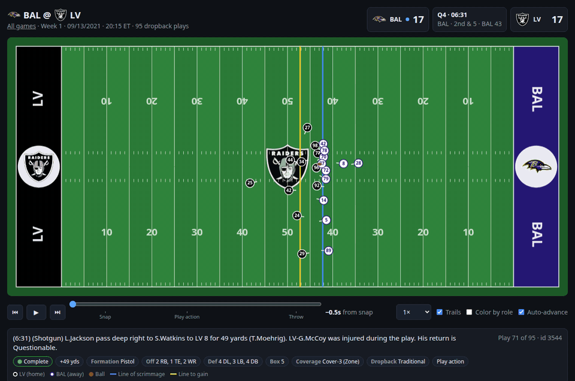

# NFL-analizer

A local web app for exploring the [NFL Big Data Bowl 2023](https://www.kaggle.com/competitions/nfl-big-data-bowl-2023)
data. Pick a game, and every dropback play appears on a clickable timeline. Select a play and
an animated field shows all 22 players and the ball, frame by frame.



*BAL @ LV, Week 1 2021: a 49-yard completion with trails on, a Maxx Crosby sack colored by PFF
role with the hover tooltip, and the overtime touchdown. [Full-resolution MP4](docs/demo.mp4).*

Each play shows:

- **Field:** players with jersey numbers, which way each one is facing, the ball, the line of
  scrimmage, the line to gain, and team logos in the end zones and at midfield.
- **Scoreboard:** quarter, clock, down and distance, and the score before the snap.
- **Play details:** result and yards, formation, personnel, defenders in the box, coverage
  scheme, dropback type and play action.
- **Game timeline:** one bar per play, grouped by quarter. Bars point up for the home team's
  possessions and down for the away team's; color shows the result and height shows yards gained.
- **Options:** movement trails, coloring by PFF role (passer, pass block, route, pass rush,
  coverage), and auto-advance to play through the whole game.

## Getting started

Requirements: Rust (`cargo`), and internet access the first time (for logos and the schedule).
The competition data is included in the repo under `data/` (about 1 GB), so there's nothing
else to download.

```sh
git clone https://github.com/Eukyrios/NFL-analyzer.git
cd NFL-analyzer
cargo run
```

The first run imports `data/` into `nfl.db` (SQLite, about 1.2 GB, about 20 s). The app then
serves http://localhost:8000 and opens your browser. Later runs start straight away. Press
Ctrl+C to stop.

Other commands:

```sh
cargo run -- serve --port 9000 --no-open    # other port (the next free one is used if it's taken), no browser
cargo run -- import                         # rebuild nfl.db from the CSVs
cargo run -- --db /path/to/nfl.db           # use a database somewhere else
cargo run -- import --data /path/to/data    # import CSVs from another folder
```

**Keys:** Space to play/pause, ← / → to step one frame, ↑ / ↓ for the previous/next play. Hover
over a player to see their name, position, PFF role and current speed.

## What the data covers

- 122 games from Weeks 1–8 of the 2021 season, with all 32 teams.
- **Only dropback passing plays** (8,557 of them). Designed runs and special teams aren't in the
  dataset.
- Tracking runs at 10 frames per second. Each play starts about 0.5 s before the snap and ends
  at the throw, sack or scramble (usually 3–4 s after the snap). The ball's flight, the catch and
  what happens after it aren't tracked.

## The database

`nfl.db` is a regular SQLite file, so you can also query it directly for analysis:

| Table | Contents |
|---|---|
| `games`, `plays`, `players`, `pff_scouting` | One table per CSV, with the same column names as the CSV headers |
| `tracking` | All 122 `tracking_<gameId>.csv` files in one table (8.3M rows), indexed on `gameId, playId, frameId` |
| `logos` | Team logos, downloaded from ESPN's CDN the first time each one is shown |

`NA` is stored as NULL, and numbers are stored as numbers. The ball's tracking rows have a NULL
`nflId`. Column meanings are in [data-README.md](data-README.md).

**Neutral-site games.** The dataset has no venue column, so on startup the app adds `location`
(Home/Neutral) and `stadium` to `games` from the
[nflverse schedule](https://github.com/nflverse/nfldata), matched on `old_game_id` = `gameId`.
Three games are neutral-site: two in London (NYJ vs ATL, MIA vs JAX) and GB vs NO, which was
moved to Jacksonville because of Hurricane Ida. These are shown as "vs" with no home team. If
the download fails, every game is treated as a home game and the download is retried on the
next start.

## How it works

The server reads straight from SQLite. Opening a game fetches its list of plays, and each play's
tracking frames are fetched when you open that play (a few milliseconds each). The next play is
fetched in the background so auto-advance doesn't pause.

| Route | Returns |
|---|---|
| `/` | Game list |
| `/game/<gameId>` | Replay page |
| `/api/game/<gameId>` | Game info and play summaries (JSON) |
| `/api/play/<gameId>/<playId>` | One play's tracking: players, roles and frames (JSON) |
| `/logos/<TEAM>.png` | Team logo |

| File | Role |
|---|---|
| `src/main.rs` | Command-line options; imports on first run, then serves |
| `src/db.rs` | CSV → SQLite import and the nflverse schedule step |
| `src/game.rs` | Queries games and plays and shapes them for the page |
| `src/serve.rs` | The HTTP server and its routes |
| `src/logos.rs` | Downloads team logos and caches them in the database |
| `timeline/viewer.html` | The replay page: canvas field, controls and timeline |

`timeline/viewer.html` is built into the program, so restart `cargo run` after editing it.

Team logos are NFL trademarks, used here only for this local demo.
