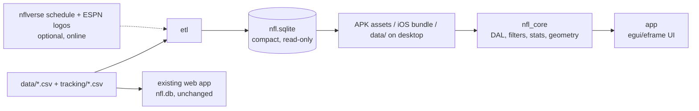
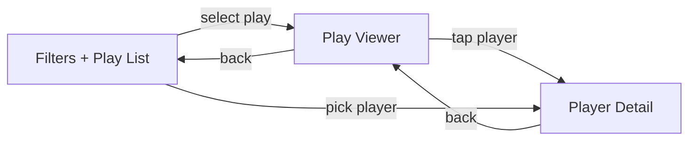

# Build Prompt: NFL Dropback & Passing Play Viewer (Rust, cross-platform)

## Goal

Build an almost-entirely-Rust app that lets users browse NFL dropback and passing plays from the NFL Big Data Bowl dataset, filter them by game, team, play state and player, watch each play animated on a field diagram from per-frame tracking data, and tap any player to see role-specific stats with charts.

The app must run on every platform: Android (APK), iOS, and desktop (Linux, macOS, Windows). Desktop doubles as the development target.

This app is added **next to** the existing web replay app in this repo. It must not remove, rewrite or change the behavior of anything that's already there (see "Existing code to preserve").

## Existing code to preserve

The repo already contains a working Rust web app (`cargo run` serves http://localhost:8000). Every task below must leave it working unchanged.

| Path | What it is | Rule |
|---|---|---|
| `Cargo.toml` (root) | The web app's package: `nfl-analizer`, binary `timeline`, `rusqlite 0.32.1` (bundled), `[profile.dev]` settings | Keep `[package]`, `[[bin]]`, `[dependencies]` and the profiles. Only **add** a `[workspace]` section (and optionally `[workspace.dependencies]`). |
| `src/` (`main.rs`, `db.rs`, `game.rs`, `serve.rs`, `logos.rs`) | Web app: CSV → `nfl.db` import, HTTP server, logo cache | Don't modify. |
| `timeline/viewer.html` | Web replay page (canvas field, timeline, controls) | Don't modify. Use it as the visual reference for the field (see "Styling"). |
| `docs/demo.gif`, `docs/demo.mp4` | README demo | Don't modify. |
| `nfl.db` (root, git-ignored, ~1.2 GB) | The web app's database: raw `tracking` table, `logos` table, `games.location`/`stadium` | Separate from this app's `data/nfl.sqlite`. Never open one app's DB from the other. |
| `.gitignore` | Ignores `target/`, `nfl.db`, `nfl.db.importing` | **Append** new entries; never replace the file. |
| `README.md` | Documents the web app and shows the demo GIF | **Add** a section for the native app; keep the existing content. |
| `data/`, `data-README.md` | The dataset (committed) | Read-only input. The ETL may write only `data/nfl.sqlite`. |

## Decisions (fixed)

- **UI stack:** `egui` + `eframe`, field drawn with `egui::Painter`, charts with `egui_plot`. Pin exact versions of `eframe`, `egui` and a matching `egui_plot`. Team logos are drawn with `egui_extras` image loading plus the pure-Rust `image` crate (PNG only).
- **Database:** SQLite via `rusqlite` with the `bundled` feature (statically linked, works on mobile). **The whole workspace must use one `rusqlite` version.** `libsqlite3-sys` declares `links = "sqlite3"`, and Cargo refuses to resolve a workspace with two versions of it, which would also break the existing web app. Declare `rusqlite = { version = "=0.32.1", features = ["bundled"] }` once in `[workspace.dependencies]` and use `rusqlite.workspace = true` in every new crate. To upgrade, upgrade the root package in the same change and confirm the web app still builds and runs.
- **Data scope:** all 122 games (weeks 1–8) and all tracking data.
- **Distribution:** a compact, read-only `nfl.sqlite` (target ≈100 MB, to be measured) is shipped inside the app package (APK assets on Android, app bundle resource on iOS). Desktop reads `data/nfl.sqlite` directly.
- **Player stats:** role-based (see "Player stats" below).
- **Theme:** NFL colors: navy `#013369`, red `#D50A0A`, white `#FFFFFF`, applied from the first UI task, not at the end. The full set of design tokens and rules is in "Styling".

## Platform notes and risks

- eframe officially supports Web, Linux, macOS, Windows and Android. **iOS is not officially supported** (open issue emilk/egui#3117). iOS needs a community setup (winit iOS backend + Xcode project, e.g. via `cargo-mobile2` or `xcodegen`) and **must be built on macOS with Xcode**; it cannot be built from the current Linux machine. Treat iOS as the highest-risk target and spike it early.
- Android build follows egui's `examples/hello_android`: `crate-type = ["cdylib", "lib"]`, an `android_main(app: AndroidApp)` entry point, `eframe` features `glow` + `android-native-activity`, the patched `cargo-apk` referenced in that README, Android SDK/NDK, targets `aarch64-linux-android` and `armv7-linux-androideabi`.
- The Android soft keyboard does not open for egui text fields (open bug emilk/egui#5590). **Do not rely on text input.** Use pickers/lists for every filter, including player selection.
- Reserve space for the Android status bar (egui's own example uses a fixed 32 pt top panel) and safe areas on iOS.
- Check the Big Data Bowl data license before distributing a build that contains the dataset. Team logos are NFL trademarks; fine for a hackathon demo, but check before distributing publicly.
- **Disk space:** the development machine currently has under 1 GB free. An eframe `target/` directory (several GB), the generated DB and the Android SDK/NDK (many GB) need roughly 15 GB free. Free space, or use another machine, before task 2.

## Dataset facts (verified against `data/`)

Files: `games.csv`, `players.csv`, `plays.csv`, `pffScoutingData.csv`, `tracking/tracking_<gameId>.csv` (122 files, one per game, ≈80k rows per game, 8,314,178 tracking rows in total). Column meanings are in `data-README.md`.

Schemas:
- `games.csv`: gameId, season, week, gameDate, gameTimeEastern, homeTeamAbbr, visitorTeamAbbr
- `players.csv`: nflId, height (text, e.g. "6-4"), weight, birthDate, collegeName, officialPosition, displayName
- `plays.csv`: gameId, playId, playDescription, quarter, down, yardsToGo, possessionTeam, defensiveTeam, yardlineSide, yardlineNumber, gameClock, preSnapHomeScore, preSnapVisitorScore, passResult (C/I/S/IN/R), penaltyYards, prePenaltyPlayResult, playResult, foulName1-3, foulNFLId1-3, absoluteYardlineNumber, offenseFormation, personnelO, defendersInBox, personnelD, dropBackType, pff_playAction, pff_passCoverage, pff_passCoverageType
- `pffScoutingData.csv`: gameId, playId, nflId, pff_role (Pass, Pass Route, Pass Block, Pass Rush, Coverage), pff_positionLinedUp, pff_hit, pff_hurry, pff_sack, pff_beatenByDefender, pff_hitAllowed, pff_hurryAllowed, pff_sackAllowed, pff_nflIdBlockedPlayer, pff_blockType, pff_backFieldBlock
- `tracking_*.csv`: gameId, playId, nflId, frameId, time, jerseyNumber, team, playDirection, x, y, s, a, dis, o, dir, event

Parsing rules:
- `NA` means NULL in every file.
- In tracking, "no event" is the literal string `None`. Treat it as NULL.
- Ball rows have `team = football` and `NA` in `nflId`, `jerseyNumber`, `o` and `dir`.
- Tracking is sampled at 10 fps.

Event facts that shape the timeline:
- Tracking usually **ends shortly after the throw** (e.g. play 97: 43 frames, `pass_forward` at frame 40). Most animations cover lineup → snap → dropback → throw/sack, about 3–6 s, with little or no ball flight.
- There is **no `dropback` event.** The dropback phase is derived as the span from snap to throw/sack.
- Events are repeated on every row of a frame (all 22 players + ball).
- Manual and automatic tags coexist: `ball_snap` / `autoevent_ballsnap`, `pass_forward` / `autoevent_passforward`. Prefer the manual tag and fall back to the auto tag.
- Other events seen: `line_set`, `man_in_motion`, `play_action`, `pass_arrived`, `pass_outcome_caught`, `pass_outcome_incomplete`, `autoevent_passinterrupted`, `dropped_pass`, `qb_sack`, `fumble`, `fumble_offense_recovered`, `run`.

Field geometry:
- Field is 120 × 53.3 yards (including end zones); x along the length, y across the width.
- `absoluteYardlineNumber` is the line of scrimmage on the tracking x-axis (play 97: 43 vs. ball x 42.92).
- `o` and `dir` are degrees measured clockwise from +y, so the direction vector is `(sin θ, cos θ)`.
- `playDirection` is `left` or `right`. Normalize plays so offense always moves left → right: `x' = 120 − x`, `y' = 53.3 − y`, angle `' = (θ + 180) mod 360`. (The web app shows the real field direction instead, so the same play can appear mirrored between the two apps. That's intentional.)

Gaps in the dataset:
- No team names, colors or logos. The app needs a built-in table of the 32 teams (abbreviation, full name, primary/secondary color). Logos are fetched by the ETL (task 4).
- **No venue and no final score.** Three games were played at neutral sites: two in London (2021101000 NYJ vs ATL, 2021101700 MIA vs JAX) and 2021091211 GB vs NO, moved to Jacksonville by Hurricane Ida. The ETL fills venue and final scores from the nflverse schedule (task 4). The schedule's `old_game_id` equals `gameId`.

## Architecture

One Cargo workspace, three new crates, plus the existing web app as the root package:

- **Root package `nfl-analizer`** (existing, unchanged): the web replay app. The root `Cargo.toml` gains `[workspace] members = ["etl", "nfl_core", "app"]` and `resolver = "2"`. `cargo run` at the repo root keeps starting the web app; the native app runs with `cargo run -p app`. Workspace-wide `[profile.*]` settings stay in the root file, which is the only place Cargo reads them.
- **`etl`** (desktop-only binary): reads the CSVs and writes a compact, indexed, read-only `data/nfl.sqlite`. Idempotent (rebuilds the file from scratch).
- **`nfl_core`** (library; do **not** name it `core`, which clashes with Rust's built-in crate): data models, read-only data access layer, filters, stats queries, frame-blob decoding, field geometry and animation helpers, team table, style tokens (plain RGB constants, no GUI types). No GUI dependency, fully unit-testable.
- **`app`** (lib + bin, `crate-type = ["cdylib", "staticlib", "lib"]`): egui/eframe UI with platform entry points (desktop `main`, Android `android_main`, iOS entry) and platform-specific DB path resolution.

`app` depends on `nfl_core`; `nfl_core` never depends on the GUI. The new crates never depend on the root package, and the root package never depends on them.

## Database design (compact)

Size matters because the DB ships inside the app. One row per tracking sample exceeds 1 GB (the web app's raw `nfl.db` is 1.2 GB), so tracking is stored as one packed blob per play.

- `games`, `players`, `plays`, `pff_scouting`: straight from the CSVs (NA → NULL, height kept as text). `games` also has nullable columns filled from the nflverse schedule: `location` (`Home`/`Neutral`), `stadium`, `home_score`, `away_score`, `overtime`.
- `teams`: abbreviation, name, primary and secondary color (from the built-in table), plus nullable `logo_png` (downscaled 128 × 128 PNG, filled by the ETL when online).
- `play_entities(gameId, playId, slot, nflId NULL, jerseyNumber NULL, team)`: the up-to-23 entities in a play; slot is the index into the frame blob; the ball has NULL nflId.
- `play_frames(gameId, playId, frame_count, blob)`: per frame, per slot: x, y (u16 centi-yards), s (u16 centi-yards/s), o, dir (u16 deci-degrees, sentinel for NULL). Already normalized to left → right. Drop `time`, `a` and `dis`. Optional compression with a pure-Rust codec (e.g. `lz4_flex` or `miniz_oxide`).
- `play_events(gameId, playId, frameId, event)`: one row per distinct event per play (not per entity), manual tags preferred over auto tags.
- `play_summary(gameId, playId, snap_frame, throw_frame NULL, sack_frame NULL, end_frame, time_to_throw NULL)`.
- `player_play_stats(gameId, playId, nflId, max_speed, avg_speed, distance)`: precomputed during ETL so runtime stats never scan tracking.
- Indexes: `plays(gameId)`, `plays(possessionTeam)`, `plays(defensiveTeam)`, `pff_scouting(nflId)`, `pff_scouting(gameId, playId)`, `player_play_stats(nflId)`, plus primary keys on (gameId, playId[, …]).
- Finish with `VACUUM` and set `PRAGMA user_version` as the schema version.

### DB delivery per platform

- **Desktop:** open `data/nfl.sqlite` (overridable via CLI arg or env var).
- **Android:** ship the DB in the APK `assets/` folder. On first launch (or when `user_version` differs), copy it via `AndroidApp::asset_manager()` to `AndroidApp::internal_data_path()`, then open read-only. SQLite cannot open files directly inside the APK.
- **iOS:** ship the DB as a bundle resource and open it read-only (`immutable=1`) from the bundle path, or copy it to Application Support on first launch.
- If the DB is missing or the schema version doesn't match, show an on-screen message instead of crashing.

## Features

### Filters + play list
- Filters: game (week → matchup), team (offense, defense or either), play state, player.
- "Play state" means: pass result, dropback type, down, quarter, coverage (`pff_passCoverage` / `pff_passCoverageType`), play action.
- Player picker: team → position → player list (no text input). Player-to-play lookup uses `pff_scouting`, not tracking.
- Distinct-value helpers populate every dropdown.
- Play list: scrollable/virtualized rows showing quarter, clock, down & distance, offense vs. defense, result, short description.

#### What every dropdown shows

Each option is a row with a **label**, a muted **detail** line or suffix, and a **count**: how many plays match if this option is picked, given the other active filters (faceted counts). Options with a count of 0 stay in the list, greyed out and sorted last, so the user can see why a combination is empty. "Any" is always the first option and shows the total.

| Dropdown | Label | Detail and count |
|---|---|---|
| Week | `Week 3` | `16 games · 1,141 plays` |
| Game | Away logo `BAL @ LV` home logo (`NYJ vs ATL` at a neutral site) | `Mon 09/13 · 20:15 ET`, final score `LV 33–27 BAL (OT)` when known, a `Neutral · Tottenham Stadium` tag when neutral, play count |
| Team | Logo (or color swatch if no logo) + `BAL` + `Baltimore Ravens` | `271 off · 258 def` |
| Side | `Offense` / `Defense` / `Either` | Play count |
| Pass result | Colored dot + `Complete`, `Incomplete`, `Sack`, `Interception`, `Scramble` | Play count and share, e.g. `4,620 · 54%` |
| Dropback type | Title case, e.g. `Designed rollout right` | Play count |
| Down | `1st` … `4th` | Play count |
| Quarter | `Q1` … `Q4`, `OT` | Play count |
| Coverage | `Cover-3` + `Zone` / `Man` / `Other` tag | The one-line description from `data-README.md` (e.g. "Any 3 Deep, 4 Under concept"), play count |
| Coverage type | `Man` / `Zone` / `Other` | Play count |
| Play action | `Yes` / `No` | Play count |
| Position (player step 2) | `CB · Cornerback` | Number of players with plays under the current filters |
| Player (player step 3) | `#44 Marlon Humphrey` + team logo | `CB · Coverage · 257 snaps`, sorted by snaps, most first |

#### Play list rows

Each row shows: `Q2 · 11:30`, `2nd & 7 · LV 39`, offense logo + abbreviation vs. defense abbreviation, a result chip in its result color with yards (`Complete +29`), the description shortened to one line, and small badges for `PA` (play action), coverage (`Cover-1`) and time to throw (`2.6 s`) when known. The selected row uses the navy selection style (see "Styling").

### Play viewer
- Field drawn to scale: end zones, yard lines with numbers, hash marks, line of scrimmage, first-down line (line of scrimmage + yardsToGo).
- All 22 players drawn as team-colored circles with jersey numbers and an orientation/heading arrow, plus the football.
- Playback at 10 fps with interpolation between frames; request repaints only while playing.
- Timeline: play/pause, scrub, speed control (0.5×, 1×, 2×), phase markers from `play_events` (line set, snap, play action, throw, sack, arrival/outcome when present) and a derived dropback span (snap → throw/sack).
- Generous hit areas around players for touch.
- Layout: the field is about 2.25:1. Use landscape on phones, or rotate the field 90° in portrait. Pick one and apply it consistently.
- Header above the field: logos and `BAL @ LV` (or `vs` at a neutral site, with no home/away labels and no midfield logo), the score before the snap, quarter and clock, and down, distance and yard line. Below the field: the play description and chips for result, yards, formation, personnel, box count, coverage and dropback type.

### Player stats (role-based)
The role comes from the player's most frequent `pff_role` (and `officialPosition` as a fallback).

- **QB (Pass):** pass result mix (C/I/S/IN/R), dropback type mix, average time to throw, sacks and pressures faced.
- **Pass blockers:** hits/hurries/sacks allowed, times beaten by defender, block type mix.
- **Pass rushers:** hits, hurries, sacks, pressure rate per rush snap.
- **Receivers (Pass Route) and Coverage:** snaps by role, max and average speed, coverage type faced/played.
- **Everyone:** header with name, position, team (with logo), height, weight, college, age; snap count; week 1–8 trend line chart of the main stat for that role.

Charts: bar charts for breakdowns, line chart for weekly trends (`egui_plot`).

### Navigation
Three screens (Filters/Play List, Play Viewer, Player Detail) driven by an `enum Screen` in app state, with in-app back buttons on every screen and Android back-button handling.

## Styling

Principles:
- **Dark UI**, so the green field is the brightest thing on screen. Dark only; no light mode.
- **NFL palette for the app around the field** (top bar, selection, primary actions).
- **The same colors as the web app for everything on the field and every color that carries meaning** (results, roles), so both apps read the same. The reference implementation is `timeline/viewer.html`.
- **Never use color alone:** every colored chip, dot or bar also has a text label, abbreviation or jersey number.

Tokens live in `nfl_core::style` as plain `(u8, u8, u8)` / `(u8, u8, u8, u8)` constants (no GUI types). `app` converts them to `egui::Color32` and builds `egui::Visuals` from them once at startup.

### App colors

| Token | Value | Use |
|---|---|---|
| `bg` | `#0B1526` | Window background |
| `surface` | `#13213A` | Panels, cards, list rows, dropdown buttons |
| `surface_raised` | `#1B2C4B` | Open dropdown popups, hovered rows |
| `border` | `#2A3B5C` | Separators, outlines, chart grid lines |
| `text` | `#FFFFFF` | Primary text |
| `text_muted` | `#9AA8BD` | Secondary text, details, axis labels (7.6:1 on `bg`) |
| `navy` | `#013369` | Top bar, selected row/option/tab fill (white text on it is 12.5:1) |
| `red` | `#D50A0A` | Primary actions (Play button), current timeline position, selected-player ring, 2 px left edge on the selected row (white text on it is 5.4:1) |

Navy and red are only used as **fills** with white text, never as text color on `bg` (red text on `bg` is 3.4:1, below the 4.5:1 minimum). Disabled and zero-count options use `text_muted` at 50% opacity.

### Field (same values as `timeline/viewer.html`)

| Element | Style |
|---|---|
| Area outside the field | `#1D5A28` |
| Grass | 5-yard stripes alternating `#2B7A37` / `#2F843C` |
| Yard lines and sidelines | White at 80% opacity, 1 px; goal lines and sidelines 2 px |
| Hash marks | 2 ft ticks at every yard, at y = 23.58 and 29.75 yd and 1 ft inside each sideline |
| Yard numbers | White at 75% opacity, bold, 2.2 yd tall, at 12 yd from each sideline; the far-side row rotated 180° |
| Line of scrimmage | `#3B82F6`, width max(2 px, 0.3 yd) |
| First-down line | `#FACC15`, same width; clamped to the goal line (shown as "& Goal") |
| End zones | Filled with the team's primary color. Plays are normalized left → right, so the left end zone belongs to the offense and the right one to the defense. Logo centered on a white circle at 92% opacity (diameter ≈ 9.3 yd), with the abbreviation rotated to read along the end zone, above and below the logo |
| Midfield | Home team logo, 11 yd wide, 90% opacity. Omitted at neutral sites |

### Players and ball

| Element | Style |
|---|---|
| Home player | Fill: team primary. Stroke: 1.5 px white. Jersey number: white, or `#111111` if the primary's relative luminance is above 0.35 |
| Away player | Fill: white. Stroke: team primary (`#333333` if light). Jersey number: team primary (`#111111` if light). This keeps similar-colored matchups (MIA vs JAX) readable. At neutral sites the same rule applies to the listed home/away teams; only the labels change |
| Size | Radius 0.95 yd, at least 6 px; numbers bold, ≈1.05 × radius, hidden below 6 px radius |
| Heading arrow | White at 90%, 2 px, from the center out to 1.7 × radius along `o` |
| Ball | Ellipse 0.6 × 0.36 yd, `#8B4A1C` with a 1 px white stroke, rotated to its direction of motion |
| Selected or hovered player | 3 px `red` ring at radius + 3 px |
| Trails (optional toggle) | Path so far, 1.5 px at 60% opacity, in the player's trail color; ball trail `#F5DEB3` |
| "Color by role" toggle | Fill by role color with a `#0D1117` stroke and number |

### Meaning colors (same as the web app)

| Pass result | Color | PFF role | Color |
|---|---|---|---|
| Complete (C) | `#3FB950` | Passer | `#FACC15` |
| Incomplete (I) | `#8B949E` | Pass block | `#60A5FA` |
| Sack (S) | `#F85149` | Route | `#2DD4BF` |
| Interception (IN) | `#F0883E` | Pass rush | `#F87171` |
| Scramble (R) | `#58A6FF` | Coverage | `#C084FC` |

Team primary colors in the `nfl_core` team table must match `TEAM_COLORS` in `timeline/viewer.html`.

### Text, spacing and controls

- Font: egui's default proportional font. Use the monospace font for the clock, scores and the time-from-snap readout, so the digits don't shift while playing.
- Sizes (desktop / phone): heading 20 / 22 pt, body 14 / 16 pt, small 12 / 13 pt.
- Spacing scale: 4, 8, 12, 16, 24 pt. Corner radius: 8 pt for panels and cards, 6 pt for buttons, fully rounded for chips.
- Minimum touch target: 44 pt on phones (iOS guideline; covers Android's 48 dp at typical densities), 28 pt on desktop.
- Icons: Unicode glyphs from egui's built-in emoji/icon font (▶ ⏸ ⏮ ⏭ and a back arrow). Check that each one renders in the task 1 placeholder; replace any that don't.
- Logos: drawn from `teams.logo_png`. If a logo is missing, draw a circle in the team's primary color with the abbreviation in white or `#111111` (same luminance rule as the jersey numbers).

### Timeline and charts

- Timeline track in `border`, filled part and thumb in `red`. Phase markers are ticks with short labels (`Snap`, `PA`, `Throw`, `Sack`) in `text_muted`. Labels that would overlap alternate between two rows. The dropback span is a band in `navy` behind the track.
- Bar charts: bars in the matching meaning color (result mix uses result colors, role breakdowns use role colors). Other breakdowns (block type, dropback type) use `#3C6FB4`. Value labels go on or next to each bar.
- Weekly trend: 2 px `red` line with point markers; grid lines in `border`; axis labels in `text_muted`; no legend for a single series.

## Implementation tasks

Each task lists the objective, tests and a demo. Do not start a task until the previous one's tests pass. Every task must also leave the existing web app building and running (`cargo build -p nfl-analizer`, then `cargo run` serves the game list).

1. **Workspace scaffold + `.gitignore`.** Add a `[workspace]` section with `members = ["etl", "nfl_core", "app"]` and `resolver = "2"` to the **existing** root `Cargo.toml`, keeping its `[package]`, `[[bin]]`, `[dependencies]` and profiles. Add `[workspace.dependencies]` with `rusqlite = { version = "=0.32.1", features = ["bundled"] }` and the other shared crates (`csv`, `serde`, `ureq`); new crates use `{ workspace = true }`. Pin other dependency versions. **Append** `data/*.sqlite` and `app/assets/*.sqlite` to the existing `.gitignore` (GitHub rejects files over 100 MB); keep `target/`, `nfl.db` and `nfl.db.importing`. Add the 32-team table (abbreviation, full name, primary and secondary color, primaries matching the web app) and the `nfl_core::style` tokens. Apply the NFL theme in a placeholder app screen that also shows a sample of each glyph from "Styling".
   *Tests:* team table has 32 unique entries covering every team abbreviation in `games.csv`; primary colors equal the web app's `TEAM_COLORS`; `cargo build -p nfl-analizer` still succeeds. *Demo:* `cargo test` and `cargo run -p app` show a themed placeholder; `cargo run` still starts the web app.

2. **Platform spike (do this early).** Get the placeholder app running on Android (APK via `cargo apk`), on iOS (Xcode project, built on macOS), and on desktop. Each build must open a tiny bundled SQLite file and display a row count.
   *Tests:* the three builds compile; document every setup step in a new "Native app" section of the README (keep the existing content). *Demo:* the placeholder screen with a DB row count on an Android device/emulator, an iOS simulator and desktop.

3. **Schema.** In `nfl_core::schema`, embedded DDL for every table and index above (including `games.location`, `stadium`, `home_score`, `away_score`, `overtime` and `teams.logo_png`), `create_all(&Connection)`, schema version via `user_version`.
   *Tests:* in-memory DB, `create_all`, assert every table, column and index exists in `sqlite_master` / `pragma_table_info`. *Demo:* `cargo test`.

4. **ETL: flat CSVs + enrichment.** Load games, players, plays and pff_scouting with `csv` + `serde`; NA → NULL; one transaction per file. Then, unless `--offline` is passed:
   - Fill `games.location`, `stadium`, `home_score`, `away_score` and `overtime` from the nflverse schedule (`https://raw.githubusercontent.com/nflverse/nfldata/master/data/games.csv`, matched on `old_game_id` = `gameId`).
   - Fill `teams.logo_png` from ESPN's CDN (`https://a.espncdn.com/i/teamlogos/nfl/500/<code>.png`, where `<code>` is the lowercase abbreviation, except `LA` → `lar` and `WAS` → `wsh`), downscaled to 128 × 128 PNG with the `image` crate.

   A failed download prints a warning and leaves those columns NULL. It never fails the build.
   *Tests:* fixture CSVs (2–3 rows each) assert row counts, sample values, and an NA → NULL case; a fixture schedule CSV marks one game `Neutral` with a stadium and final score; `--offline` leaves the enrichment columns NULL. *Demo:* `cargo run -p etl -- --fixtures`.

5. **ETL: tracking → compact tables.** For each tracking file: group by play, normalize direction, build `play_entities` and the packed `play_frames` blob, dedupe events into `play_events` (manual over auto, `None` → no event), compute `play_summary` and `player_play_stats`. Log per-file timing and final row counts. Finish with `VACUUM`. Print the final DB size and copy the DB to `app/assets/`.
   *Tests:* fixture tracking file checks frame counts, ball row has NULL nflId, blob encode/decode round-trips within quantization error, normalization of a `left` play, event dedup, snap/throw frames. *Demo:* `cargo run -p etl --release` builds the full DB and reports its size.

6. **Core models + DAL.** Structs (Game, Team, Player, Play, PffScouting, PlayEntity, PlayFrames, PlayEvent, PlaySummary) and a read-only `Db` wrapper: list games, teams (with logo bytes), plays for a game, play by id, player by id, decoded frames for a play. `Game` exposes `is_neutral()` and the final score when known.
   *Tests:* seeded in-memory DB, each query returns the expected shapes; a neutral game reports `is_neutral()`. *Demo:* `cargo test`.

7. **Filters.** `PlayFilter` (game, team + side, play-state fields, nflId via `pff_scouting`) and `query_plays(&filter)`. Dynamic SQL with bound parameters only. Distinct-value helpers for every dropdown and the team → position → player picker. Each helper returns `Vec<FacetOption { value, label, detail, count }>`, where `count` is the number of plays matching with that option applied on top of the other active filters, and the details listed in "What every dropdown shows" (game date/time, final score and neutral tag; team full name and offense/defense counts; coverage descriptions; player jersey, position, main role and snap count).
   *Tests:* each filter dimension and combinations on seeded data; for a single-choice facet, the option counts add up to the "Any" total; zero-count options are returned last; labels for pass results, downs, quarters and dropback types. *Demo:* `cargo test`.

8. **Role-based player stats.** `player_role(nflId)` and `player_stats(nflId)` returning plain structs per role, plus weekly trend series, all from SQL aggregates over `plays`, `pff_scouting`, `play_summary` and `player_play_stats`.
   *Tests:* seeded data asserts counts, rates, mean speed and role detection for a QB, a blocker and a rusher. *Demo:* `cargo test`.

9. **Geometry + animation helpers.** Field-to-screen mapping for a viewport (landscape and rotated portrait), angle → vector, frame interpolation, phase markers and dropback span from `play_events`/`play_summary`, line of scrimmage and first-down line positions (clamped to the goal line), player hit-testing, and the luminance rule for text on team colors.
   *Tests:* corners map correctly in both orientations, angle 0° points to +y, 90° to +x, interpolation midpoint, marker extraction, hit-test returns the closest nflId within the radius, light team colors (e.g. `NO`, `PIT`) get dark text. *Demo:* `cargo test`.

10. **App shell + navigation.** eframe app with `enum Screen`, back buttons, Android back handling, status bar / safe area spacing, platform DB path resolution (desktop path, Android asset copy, iOS bundle), graceful "DB missing" screen. Build `egui::Visuals` and text styles from `nfl_core::style` (colors, sizes, spacing, corner radii, touch-target minimums per platform) and load team logos as textures once.
    *Tests:* state test: default screen is Filters, back navigation works. *Demo:* `cargo run -p app` against the real DB, fully themed.

11. **Filters + play list screen.** All pickers, filter changes recompute `query_plays` and every facet's counts, virtualized play list, tap → Play Viewer. Dropdown options and play-list rows render exactly as described in "What every dropdown shows" and "Play list rows" (logos, detail lines, counts, greyed zero-count options, navy selection with red left edge).
    *Tests:* state test: applying a filter updates the stored play list and the other facets' counts. *Demo:* pick a team and pass result, see counts update in the other dropdowns, open a play.

12. **Animated play viewer.** Field drawing, players, ball, arrows, jersey numbers, timeline with play/pause, scrub, speed and phase markers, header and detail chips, all styled per "Styling" (end-zone logos on badges, midfield logo except at neutral sites, home/away contrast rule).
    *Tests:* state test: play/pause/scrub/speed advance the frame index correctly; a neutral-site game shows no midfield logo and no home/away labels. *Demo:* a full play animates on desktop and Android; a London game shows "vs".

13. **Player detail + tap-through.** Tap a player in the viewer (or pick one in Filters) → detail screen with the role-specific charts and the weekly trend, styled per "Timeline and charts"; back returns to the previous screen.
    *Tests:* state test: tap position maps to the correct nflId and loads that player's stats. *Demo:* tap a QB, then a rusher, and see different chart sets.

14. **Polish + release builds.** Extend the README's "Native app" section with the full flow (ETL → bundle DB → build per platform), keeping the web app documentation and demo. Release APK (signed debug key is fine for the hackathon), iOS simulator/device build, desktop release build, performance check on a real phone.
    *Tests:* manual run of all three screens on each platform against the real DB; the web app still works (`cargo run`, open a game, play a play). *Demo:* from a clean checkout: run ETL, build the APK, install, browse → filter → animate → tap player → charts.

## Engineering rules

- `nfl_core` must stay GUI-free; all math, queries, decoding and style tokens live there, and the logic is unit-tested.
- SQL uses bound parameters only, never string-interpolated values.
- All runtime DB access is read-only.
- Functions return `Result`; no `unwrap()` outside tests and the top-level entry points.
- Pin exact dependency versions; prefer pure-Rust crates for mobile portability.
- One `rusqlite` version for the whole workspace, declared in `[workspace.dependencies]`.
- Never commit the generated DB (`data/nfl.sqlite`, `app/assets/*.sqlite`, `nfl.db`) or `target/`.
- Don't modify the existing web app (`src/`, `timeline/`, `docs/`, the root package's dependencies). The root `Cargo.toml` only gains workspace sections. `.gitignore` and `README.md` are only appended to.
- Network access is allowed only in the `etl` crate (schedule and logos), always optional, and never at app runtime.

## Definition of done

- `cargo test --workspace` passes.
- The ETL builds the full DB from `data/` and reports its final size; with network access, every game has a `location` and every team has a logo.
- The APK installs and runs on an Android device/emulator with the bundled DB.
- The iOS build runs on a simulator or device (built on macOS).
- Desktop runs on Linux (and macOS/Windows where available).
- On every platform: filter plays (with counts in every dropdown), animate a play with working timeline markers, tap a player, see role-specific charts, navigate back.
- The existing web app still builds, `cargo run` at the repo root still serves it, and its README section and demo are unchanged.
